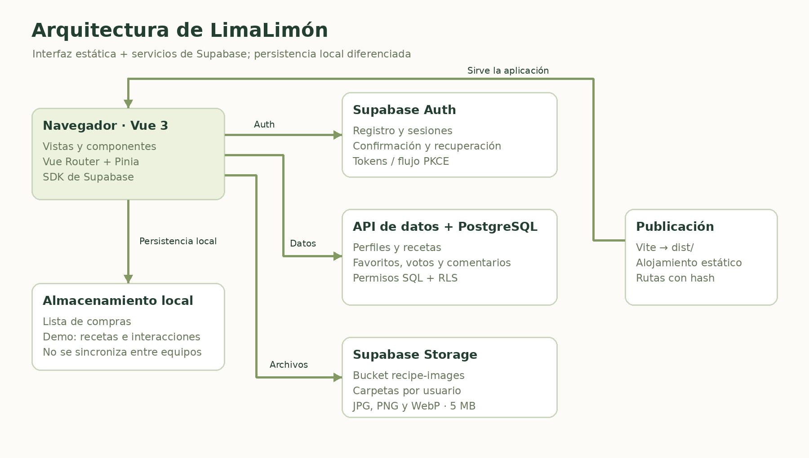
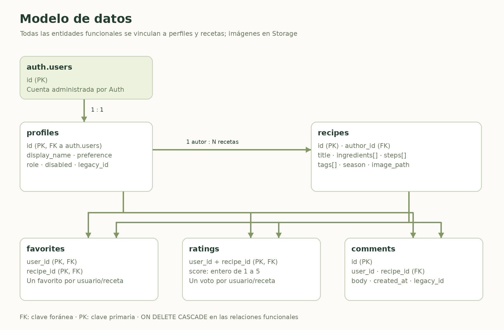
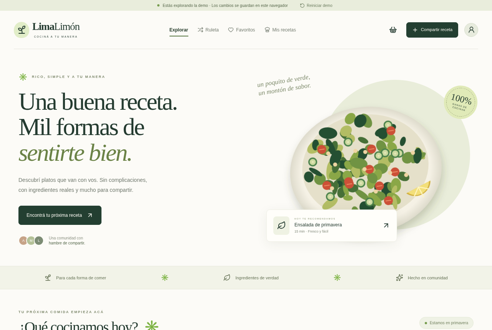
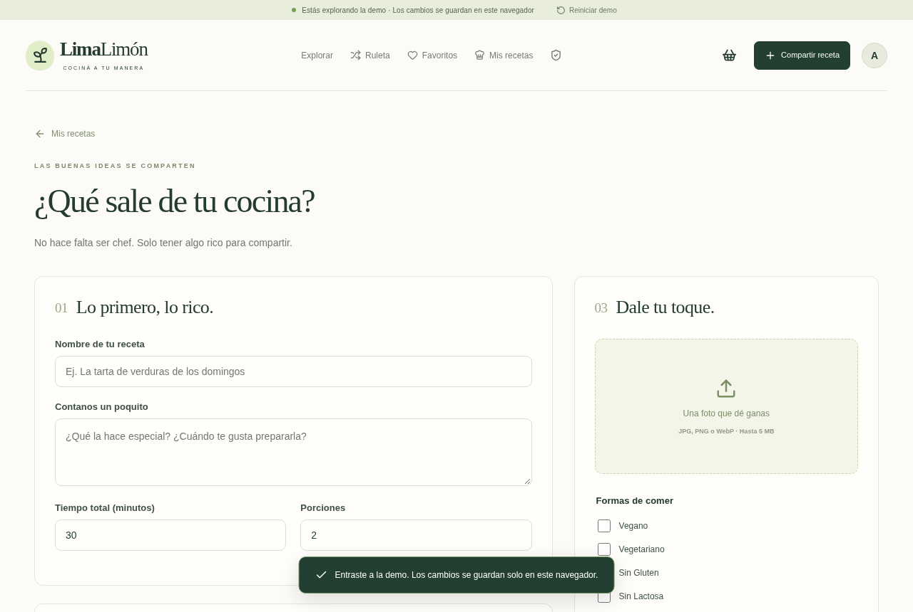
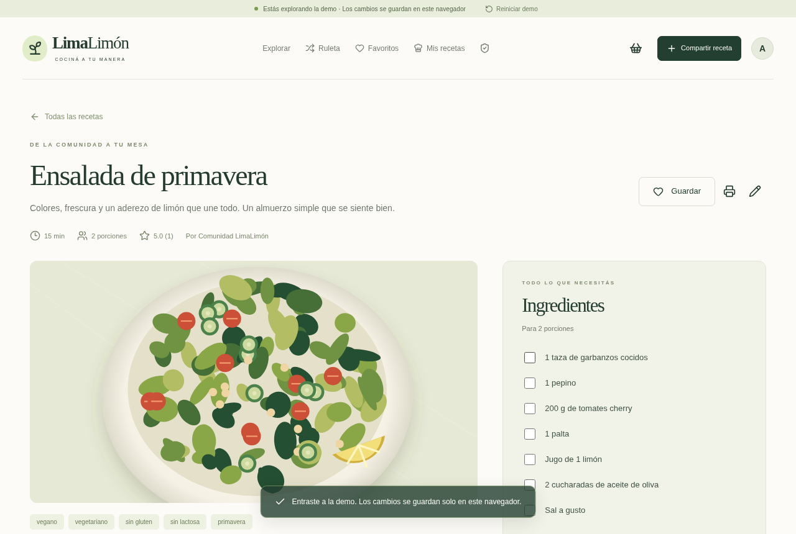
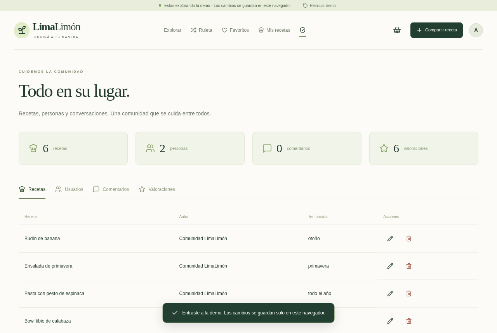

# 1. Presentación y alcance del documento

**LimaLimón · Cociná a tu manera** es una aplicación web comunitaria para descubrir, publicar y organizar recetas, con atención a diferentes preferencias e intolerancias alimentarias. Este documento reúne la descripción funcional, la arquitectura técnica, el modelo de datos, las instrucciones de instalación y publicación, la migración desde el sistema original y los procedimientos de uso y mantenimiento.

La versión documentada utiliza Vue 3 y TypeScript en la interfaz y Supabase como plataforma de autenticación, base de datos PostgreSQL y almacenamiento de imágenes. El proyecto original fue desarrollado con PHP y MySQL; sus archivos se conservan como referencia y fuente de migración.

**Referencia de la revisión:** rama `feat/vue-supabase`, commit `79a6b5f`. Repositorio: <https://github.com/nicori25/Recetas_limalimon1>. Fecha de corte: 10 de noviembre de 2026, Buenos Aires. Este archivo documenta el estado del código; no constituye una certificación de disponibilidad del servicio remoto.

## 1.1. Destinatarios

- Personas que evalúan o presentan el proyecto y necesitan comprender su finalidad y alcance.
- Usuarios y administradores que necesitan instrucciones de uso.
- Desarrolladores que instalarán, modificarán o publicarán la aplicación.
- Responsables del proyecto que configurarán Supabase y trasladarán los datos originales.

## 1.2. Estado al momento de la entrega

| Área | Estado documentado |
|---|---|
| Aplicación Vue | Implementada y compilada en la revisión indicada. |
| Proyecto de Supabase | URL y clave pública incluidas como configuración predeterminada. |
| Esquema remoto | El propietario informó que ejecutó el SQL. No fue posible comprobarlo desde este entorno. |
| Conexión remota | Pendiente de verificación: las solicitudes desde el entorno fueron bloqueadas por su política de red. |
| Datos originales | Exportación e importador preparados; sin importación remota ejecutada. |
| Autenticación y Storage reales | Integración implementada; confirmación de correo, recuperación y carga remota pendientes de prueba en el proyecto real. |
| Demo | Funcional, con seis recetas ilustrativas y persistencia en el navegador. |
| Publicación del sitio | Configuración de compilación disponible; no se confirmó un despliegue de esta versión. |

Las capturas de este documento corresponden exclusivamente a la demo. No representan registros existentes en Supabase ni cuentas reales.

# 2. Índice de contenidos

1. Presentación y alcance del documento.
2. Índice de contenidos.
3. Problema, propósito y objetivos.
4. Alcance funcional y actores.
5. Requisitos y reglas de negocio.
6. Arquitectura y tecnologías.
7. Organización del código y navegación.
8. Modelo de datos y relaciones.
9. Diccionario de datos.
10. Autenticación, permisos y almacenamiento.
11. Instalación y configuración.
12. Migración de PHP/MySQL a Supabase.
13. Manual de usuario.
14. Manual de administración.
15. Publicación y operación.
16. Pruebas y criterios de aceptación.
17. Mantenimiento, respaldo y resolución de problemas.
18. Limitaciones y evolución propuesta.
19. Glosario y referencias.
20. Anexos: comandos, ejemplos y esquema SQL completo.

Los títulos de Word permiten navegar por las secciones desde el panel de navegación. El diccionario y el esquema SQL permiten consultar la estructura sin depender de enlaces externos.

# 3. Problema, propósito y objetivos

## 3.1. Problema que aborda

Encontrar ideas para cocinar puede resultar difícil cuando intervienen preferencias alimentarias, disponibilidad de ingredientes y tiempo de preparación. Las recetas dispersas también dificultan conservar favoritos y organizar compras. LimaLimón reúne estas tareas en un mismo sitio y permite que la comunidad aporte nuevas propuestas.

El proyecto utiliza categorías como vegano, vegetariano, sin gluten y sin lactosa. También admite etiquetas adicionales aportadas por quien publica, de modo que el catálogo no quede limitado a una lista fija de preferencias.

## 3.2. Objetivo general

Ofrecer una experiencia accesible desde computadoras y celulares para descubrir, compartir y preparar recetas compatibles con la forma de comer de cada persona.

## 3.3. Objetivos específicos

- Facilitar búsquedas por nombre, descripción e ingredientes, sin distinguir tildes ni mayúsculas.
- Combinar preferencias alimentarias, temporada y tiempo máximo en una misma búsqueda.
- Permitir que cada usuario gestione sus recetas, favoritos, comentarios y valoraciones.
- Organizar ingredientes en una lista de compras y facilitar la preparación paso a paso.
- Incorporar autenticación y permisos de acceso aplicados en la base de datos.
- Preservar las funciones originales al renovar la interfaz y preparar una migración trazable.

## 3.4. Criterios de identidad

Se conserva el nombre LimaLimón, la temática de recetas y la orientación comunitaria. La interfaz utiliza verde oscuro, tonos lima y fondos claros, con textos en español rioplatense. Las ilustraciones de la demo acompañan la presentación; las recetas reales pueden usar fotografías cargadas por sus autores.

Las etiquetas no son certificaciones médicas o alimentarias. Quien cocina debe revisar los productos utilizados y las condiciones de preparación, especialmente en situaciones de alergia, celiaquía o intolerancia.

# 4. Alcance funcional y actores

## 4.1. Actores del sistema

| Actor | Capacidades |
|---|---|
| Visitante | Explorar recetas, buscar, filtrar, leer pasos y comentarios, consultar valoraciones, usar la ruleta y la lista de compras local. |
| Usuario autenticado y activo | Publicar y gestionar recetas propias; guardar favoritos; valorar y comentar; modificar su nombre y preferencia alimentaria. |
| Administrador activo | Gestionar recetas de la comunidad, moderar comentarios y valoraciones, cambiar roles y activar, desactivar o eliminar otras cuentas. |
| Cuenta desactivada | Conserva sus datos hasta que se eliminen; la base impide escrituras y cargas de imágenes. La interfaz intenta cerrar su sesión al actualizar el perfil. |

El modo demo utiliza una identidad ficticia con permisos de administración para permitir la evaluación. Esos permisos locales no equivalen a un administrador de Supabase.

## 4.2. Casos de uso principales

| Identificador | Caso | Resultado esperado |
|---|---|---|
| CU-01 | Explorar y filtrar | Se muestran las recetas que cumplen todos los filtros elegidos. |
| CU-02 | Crear una cuenta | Supabase registra la cuenta y el trigger crea su perfil de usuario. |
| CU-03 | Publicar una receta | Se guarda una receta vinculada al autor; opcionalmente se carga una imagen. |
| CU-04 | Editar o eliminar | El autor o un administrador autorizado modifica o elimina la receta. |
| CU-05 | Guardar favoritos | Se agrega o quita una relación privada entre usuario y receta. |
| CU-06 | Valorar y comentar | Se registra un voto por usuario y receta y se agregan comentarios independientes. |
| CU-07 | Resolver qué cocinar | La ruleta elige una receta entre las compatibles con temporada y preferencia. |
| CU-08 | Preparar la comida | Se consultan ingredientes, se agregan a compras y se recorren los pasos en modo cocina. |
| CU-09 | Administrar comunidad | Se revisa y modera contenido desde el panel de administración. |

## 4.3. Elementos fuera del alcance actual

No se implementan pagos, entregas, inventario de alimentos, asesoramiento nutricional profesional ni cálculo automático de calorías. Tampoco se sincroniza la lista de compras entre dispositivos, se certifican alérgenos o se actualizan datos mediante suscripciones en tiempo real.

# 5. Requisitos y reglas de negocio

## 5.1. Requisitos funcionales

| Código | Requisito | Implementación principal |
|---|---|---|
| RF-01 | Consultar catálogo y detalle | ExploreView y RecipeView. |
| RF-02 | Buscar y combinar filtros | filterRecipes en src/lib/utils.ts. |
| RF-03 | Gestionar sesiones y recuperación | AccountView y Supabase Auth. |
| RF-04 | Crear, editar y eliminar recetas | EditorView y acciones del store. |
| RF-05 | Gestionar favoritos personales | CollectionView y tabla favorites. |
| RF-06 | Comentar y valorar | RecipeView; tablas comments y ratings. |
| RF-07 | Consultar recetas propias | CollectionView en la ruta mis-recetas. |
| RF-08 | Elegir recetas de temporada | RouletteView. |
| RF-09 | Organizar compras y preparación | ShoppingView y modo cocina. |
| RF-10 | Moderar usuarios y contenido | AdminView, políticas RLS y funciones RPC. |

## 5.2. Requisitos de calidad

La interfaz se adapta a pantallas pequeñas y grandes. Se emplean etiquetas de formulario, indicadores de foco, enlace para saltar al contenido y diálogos nativos. Las animaciones respetan la preferencia de movimiento reducido. Estas medidas mejoran la accesibilidad, pero no equivalen a una auditoría completa de conformidad WCAG.

El código utiliza tipos de TypeScript, componentes reutilizables y un archivo de dependencias bloqueadas. Las rutas cargan vistas de forma diferida. Las lecturas recorren bloques de hasta 1000 filas para evitar el truncamiento silencioso del límite predeterminado de Supabase; el filtrado sigue realizándose en el navegador.

La seguridad de autorización se aplica mediante permisos SQL y RLS. Ocultar botones en la interfaz mejora la experiencia, pero no reemplaza las políticas de la base.

## 5.3. Reglas de negocio

- Una receta pertenece a un único perfil. Un perfil puede publicar varias recetas.
- Se permite un favorito y una valoración por combinación usuario–receta. Valorar nuevamente actualiza el voto.
- Cada valoración es un entero entre 1 y 5. La interfaz calcula su promedio para mostrarlo.
- Los filtros alimentarios se combinan con lógica AND: la receta debe incluir todas las etiquetas seleccionadas.
- La búsqueda exige todas las palabras ingresadas, comparadas con título, descripción e ingredientes normalizados.
- Una receta de «todo el año» también es elegible al filtrar por una estación específica.
- La estación se calcula con meses del hemisferio sur en el huso America/Argentina/Buenos_Aires: diciembre–febrero, verano; marzo–mayo, otoño; junio–agosto, invierno; septiembre–noviembre, primavera.
- El administrador no puede cambiar sus propios permisos ni eliminar su propia cuenta mediante las funciones de administración.
- Las cuentas nuevas reciben el rol usuario; los metadatos del registro no pueden conceder el rol admin.
- Al eliminar una receta se borran sus favoritos, comentarios y valoraciones por cascada. Al eliminar un perfil se borran sus recetas e interacciones dependientes.

# 6. Arquitectura y tecnologías

## 6.1. Visión general

La aplicación es una SPA: el navegador descarga archivos estáticos y Vue controla las vistas. Vue Router resuelve la navegación; Pinia reúne el estado y las acciones. El SDK de Supabase conecta el cliente con Auth, la API de datos y Storage. PostgreSQL aplica las restricciones y los permisos sobre cada operación.

{width=6.4in}

## 6.2. Tecnologías utilizadas

| Componente | Tecnología | Responsabilidad |
|---|---|---|
| Interfaz | Vue 3, Composition API | Vistas, formularios y componentes reactivos. |
| Tipado | TypeScript 5.9 | Modelos y verificación durante la compilación. |
| Compilación | Vite 7 | Servidor de desarrollo y build de producción. |
| Navegación | Vue Router 4 | Rutas con hash y carga diferida de vistas. |
| Estado | Pinia 3 | Sesión, perfiles, recetas e interacciones. |
| Plataforma de datos | Supabase | Auth, PostgreSQL, API de datos y Storage. |
| Iconografía | @lucide/vue | Iconos de interfaz. |
| Pruebas | Vitest y Playwright | Pruebas de lógica y recorridos de navegador. |
| Permisos SQL | PostgreSQL 17 en Docker para pruebas | Validación aislada del esquema y las políticas. |
| Formato y automatización | Prettier y GitHub Actions | Estilo del código y verificación continua. |

Las versiones exactas instalables se determinan en package-lock.json; package.json declara rangos de compatibilidad. Node.js 22.12 o superior es un requisito; se recomienda Node 24 y se incluye .nvmrc.

## 6.3. Persistencia y límites entre capas

En el modo real, recetas, perfiles e interacciones se almacenan en Supabase. Los archivos se alojan en el bucket recipe-images. La sesión se gestiona con Supabase Auth. La lista de compras permanece en localStorage incluso en modo real.

En la demo no se utilizan cuentas remotas. Recetas e interacciones de ejemplo se almacenan con la clave local limalimon-demo-v2 y la lista de compras usa limalimon-shopping-v1. Borrar los datos del navegador puede eliminar esta información. La demo no es una copia de seguridad.

# 7. Organización del código y navegación

## 7.1. Directorios principales

```text
src/
  components/      Tarjetas, control de acceso y diálogos
  data/            Recetas e identidades ficticias de la demo
  lib/             Tipos, utilidades y configuración de Supabase
  stores/          Estado y acciones de la aplicación
  views/           Pantallas funcionales
  main.ts          Inicio de Vue, Pinia y Router
  router.ts        Definición de rutas
  style.css        Estilos y adaptación a distintos tamaños
public/            Ilustraciones e icono del sitio
supabase/
  migrations/      Esquema SQL, permisos y almacenamiento
  config.toml      Configuración de Supabase local
scripts/           Exportador, importador y pruebas de base
tests/            Pruebas de lógica, navegador y SQL
docs/              Guía técnica de migración
documentacion/    Documentación original y este paquete
```

Los archivos PHP de la raíz y sql/limalimon1.sql pertenecen a la versión anterior. La nueva aplicación se construye desde index.html y src/. No deben confundirse los entrypoints de PHP y Vue al publicar.

## 7.2. Rutas de la versión Vue

| Ruta después del hash | Vista | Uso |
|---|---|---|
| / | ExploreView | Inicio, búsqueda y filtros. |
| /receta/:id | RecipeView | Detalle y participación. |
| /publicar | EditorView | Nueva receta. |
| /editar/:id | EditorView | Edición de receta autorizada. |
| /favoritos | CollectionView | Favoritos de la cuenta. |
| /mis-recetas | CollectionView | Recetas de la cuenta. |
| /ruleta | RouletteView | Selección aleatoria por temporada. |
| /compras | ShoppingView | Lista local de ingredientes. |
| /cuenta | AccountView | Acceso, registro, perfil y recuperación. |
| /admin | AdminView | Moderación y gestión. |
| Cualquier otra | NotFoundView | Página no encontrada. |

Las direcciones usan el formato https://tu-sitio/#/receta/UUID. El hash evita exigir reglas de reescritura al alojamiento estático. Los controles de acceso de las vistas se complementan con RLS; no hay que interpretar una ruta accesible como un permiso de escritura.

## 7.3. Store y tratamiento de errores

El store central inicializa el modo real o demo, carga las entidades y expone acciones como saveRecipe, toggleFavorite, rate y moderateUser. En una operación remota se comprueba el error antes de actualizar el estado local. Los mensajes distinguen errores de credenciales, correo sin confirmar, límites de intentos, fallos de red y permisos insuficientes.

La actualización del estado de Auth se difiere fuera del callback para evitar bloqueos de autenticación al realizar otras consultas de Supabase. No se implementan suscripciones Realtime: para incorporar cambios de otras sesiones es necesaria una nueva carga o actualización de los datos.

# 8. Modelo de datos y relaciones

El modelo de aplicación tiene cinco tablas en public: profiles, recipes, favorites, ratings y comments. Supabase administra las cuentas en auth.users y los archivos mediante su esquema storage.

{width=6.4in}

## 8.1. Cardinalidades

| Relación | Cardinalidad y efecto |
|---|---|
| auth.users → profiles | Un perfil por cuenta; el identificador del perfil es el mismo UUID. |
| profiles → recipes | Uno a muchos: cada receta tiene un autor. |
| profiles ↔ recipes mediante favorites | Muchos a muchos; favorito único por par usuario–receta. |
| profiles ↔ recipes mediante ratings | Muchos a muchos; una puntuación por par. |
| profiles → comments | Un usuario puede escribir varios comentarios. |
| recipes → comments | Una receta puede recibir varios comentarios. |

Las claves foráneas funcionales usan ON DELETE CASCADE. El borrado relacional no elimina automáticamente los archivos físicos de Storage. La limpieza de objetos sin referencias requiere un procedimiento independiente.

## 8.2. Trazabilidad de la migración

profiles, recipes y comments incluyen legacy_id, un entero opcional y único. Permite conservar el vínculo con los identificadores antiguos y repetir una importación controlada sin duplicar esas entidades. favorites y ratings se identifican mediante sus claves compuestas; no requieren un identificador legacy separado.

# 9. Diccionario de datos

## 9.1. profiles

| Campo | Tipo | Restricción / finalidad |
|---|---|---|
| id | uuid | PK y FK a auth.users.id. |
| display_name | text | Obligatorio; entre 1 y 80 caracteres al recortar espacios. |
| dietary_preference | text | Preferencia; predeterminado vacío; hasta 100 caracteres. |
| role | text | usuario o admin; predeterminado usuario. |
| disabled | boolean | Predeterminado false; bloquea escrituras cuando vale true. |
| legacy_id | bigint | Opcional y único; referencia a MySQL. |
| created_at | timestamptz | Fecha y hora predeterminadas por el servidor. |

Los perfiles no almacenan correo ni contraseña. El nombre, la preferencia y el rol se pueden consultar públicamente mediante las políticas actuales. El correo y las credenciales corresponden a Auth.

## 9.2. recipes

| Campo | Tipo | Restricción / finalidad |
|---|---|---|
| id | uuid | PK; generado con gen_random_uuid(). |
| author_id | uuid | FK obligatoria a profiles. |
| title | text | Obligatorio; entre 1 y 140 caracteres. |
| description | text | Obligatoria; entre 1 y 1500 caracteres. |
| ingredients | text[] | De 1 a 100 elementos; total de hasta 15000 caracteres. |
| steps | text[] | De 1 a 100 elementos; total de hasta 30000 caracteres. |
| dietary_tags | text[] | Predeterminado vacío; hasta 20 etiquetas y 800 caracteres en conjunto. |
| season | text | primavera, verano, otoño, invierno o todo el año. |
| image_path | text | Opcional; ruta de archivo, hasta 300 caracteres. No admite URL HTTP ni data URL en la base. |
| prep_minutes | integer | Entre 1 y 2880; predeterminado 30. |
| servings | integer | Entre 1 y 100; predeterminado 2. |
| legacy_id | bigint | Opcional y único. |
| created_at | timestamptz | Fecha y hora de creación. |

Los ingredientes y pasos se ingresan como líneas en el formulario y se convierten en arreglos. Los límites de texto acumulado son controles SQL; los formularios agregan sus propias validaciones.

## 9.3. favorites y ratings

| Tabla | Campo | Tipo / condición |
|---|---|---|
| favorites | user_id | uuid, FK a profiles. Parte de la PK. |
| favorites | recipe_id | uuid, FK a recipes. Parte de la PK. |
| ratings | user_id | uuid, FK a profiles. Parte de la PK. |
| ratings | recipe_id | uuid, FK a recipes. Parte de la PK. |
| ratings | score | integer obligatorio, de 1 a 5. |

Ambas claves primarias compuestas impiden duplicados del mismo par. Los favoritos son privados; las valoraciones son de lectura pública y permiten calcular el promedio.

## 9.4. comments

| Campo | Tipo | Restricción / finalidad |
|---|---|---|
| id | uuid | PK generada automáticamente. |
| user_id | uuid | FK obligatoria a profiles. |
| recipe_id | uuid | FK obligatoria a recipes. |
| body | text | Obligatorio; entre 1 y 2000 caracteres. |
| legacy_id | bigint | Opcional y único. |
| created_at | timestamptz | Fecha y hora del comentario. |

No existe una operación de edición de comentarios en esta versión. El autor y el administrador pueden eliminarlos según las políticas.

## 9.5. Índices y archivos

Se incluyen índices por autor y fecha de receta, un índice GIN para dietary_tags y otros por receta en comentarios, favoritos y valoraciones. Las claves primarias y las restricciones unique crean sus índices correspondientes. El filtrado del catálogo actual ocurre en el cliente; un índice GIN disponible no implica que la interfaz ya ejecute búsqueda remota por etiquetas.

El bucket recipe-images es público. Admite image/jpeg, image/png e image/webp y un tamaño máximo de 5242880 bytes por objeto. La ruta de carga normal es UUID_DEL_USUARIO/UUID_DEL_ARCHIVO.extensión.

# 10. Autenticación, permisos y almacenamiento

## 10.1. Flujo de autenticación

El registro solicita nombre, correo y contraseña. Supabase crea la cuenta y el trigger on_auth_user_created agrega un perfil con rol usuario. La confirmación de correo depende de la configuración de Auth. El acceso utiliza signInWithPassword; la recuperación utiliza resetPasswordForEmail y updateUser.

El cliente está configurado para persistir sesión, renovar tokens y procesar la devolución de Auth con flujo PKCE. Para recuperación se utiliza el parámetro flow=recovery y la vista de cuenta permite definir una nueva contraseña. El frontend solicita como mínimo 8 caracteres para registro y recuperación; el proyecto de Supabase debe configurarse de forma coherente.

## 10.2. Matriz de autorización

| Recurso | Lectura | Creación | Modificación / eliminación |
|---|---|---|---|
| Perfiles | Pública | Trigger de Auth | Propietario activo: solo nombre y preferencia. Roles y estado: función de administrador. |
| Recetas | Pública | Usuario activo, con su propio author_id | Autor activo o administrador activo. |
| Favoritos | Solo propietario activo | Propietario activo | El propietario puede eliminarlos. No se actualizan. |
| Valoraciones | Pública | Propietario activo | Propietario: actualizar. Propietario activo o admin: eliminar. |
| Comentarios | Pública | Autor activo | Autor activo o admin: eliminar. Sin permiso de actualización. |
| Imágenes | Pública en el bucket | Usuario activo, dentro de su carpeta | Eliminación por propietario activo de carpeta o admin. No se concede actualización de objetos al cliente. |

RLS está activada en las cinco tablas de la aplicación. Además, los permisos de columna impiden que un usuario cambie role o disabled por una actualización ordinaria de profiles. Las funciones sensibles usan SECURITY DEFINER con search_path vacío y verifican el rol del actor.

## 10.3. Funciones y trigger

| Nombre | Función |
|---|---|
| is_active_user() | Comprueba que el perfil de auth.uid() exista y no esté desactivado. |
| is_admin() | Comprueba rol admin y estado activo en el perfil. |
| handle_new_user() | Crea un perfil de usuario al insertar una cuenta de Auth. |
| admin_update_user(target_id, new_role, new_disabled) | Modifica rol y estado de otro perfil; valida actor y parámetros. |
| admin_delete_user(target_id) | Elimina otra cuenta de Auth y activa las cascadas relacionales. |

## 10.4. Configuración pública y privada

La URL y la clave publishable se incluyen en el navegador por diseño. El archivo src/lib/supabase.public.ts contiene el proyecto predeterminado. Las variables VITE_SUPABASE_URL y VITE_SUPABASE_PUBLISHABLE_KEY, o VITE_SUPABASE_ANON_KEY, permiten sustituirlo durante la compilación.

Una clave service_role o sb_secret_ es privada y no debe agregarse a esos archivos ni a variables VITE_. El cliente intenta detectar esos formatos para evitar utilizarlos en la interfaz. El importador requiere permisos de servidor y debe ejecutarse desde un proceso privado con SUPABASE_SERVICE_ROLE_KEY.

# 11. Instalación y configuración

## 11.1. Requisitos de desarrollo

Se necesita Git, Node.js 22.12 o superior y npm. Se recomienda Node 24, coincidente con .nvmrc y la integración continua. Para pruebas SQL se requiere Docker; para E2E se necesita Chromium o el navegador instalado por Playwright. PHP y MySQL solo son necesarios para ejecutar el sistema antiguo o exportar sus datos.

## 11.2. Obtener y ejecutar la aplicación

```bash
git clone --branch feat/vue-supabase https://github.com/nicori25/Recetas_limalimon1.git
cd Recetas_limalimon1
npm ci
npm run dev
```

Usar el origen y puerto informados por Vite. npm ci instala las versiones fijadas en package-lock.json. No es necesario arrancar el PHP antiguo para usar Vue.

## 11.3. Selección del proyecto y modo demo

Sin overrides, la aplicación utiliza https://syojuxibmkarhtweuqfv.supabase.co. Si está definida alguna variable de configuración, se utiliza exclusivamente ese conjunto y no se mezclan los valores con los del proyecto predeterminado.

| Situación | Resultado |
|---|---|
| Sin variables de override | Se utiliza el proyecto público incluido. |
| URL y clave pública completas | Se utiliza el proyecto indicado en las variables. |
| Ambas variables explícitamente vacías | Se utiliza la demo local. |
| Configuración parcial o URL no válida | Se muestra un error; no se recurre silenciosamente a la demo. |
| Fallo al consultar el proyecto real | Se muestra el error de conexión o de datos. |

Para activar la demo se copia .env.example a .env.local y se dejan los dos valores vacíos. Para usar otro proyecto se completan ambos. Reiniciar Vite después de cambiar variables; en producción es necesario volver a compilar. Los archivos locales .env.local no deben publicarse.

```dotenv
VITE_SUPABASE_URL=https://TU-PROYECTO.supabase.co
VITE_SUPABASE_PUBLISHABLE_KEY=TU_CLAVE_PUBLICA
```

## 11.4. Preparar Supabase

1. Crear un proyecto o utilizar el proyecto previsto para LimaLimón.
2. Si es un proyecto vacío, ejecutar una sola vez el SQL del anexo o la migración incluida en supabase/migrations. Si ya se aplicó, no repetirlo: utiliza CREATE TABLE y no es idempotente.
3. Verificar las cinco tablas, el trigger de Auth, las funciones y el bucket recipe-images.
4. Configurar Site URL y Redirect URLs para el origen de desarrollo y el dominio publicado. Incluir el retorno con ?flow=recovery.
5. Mantener la confirmación de correo y configurar el servicio de correo/SMTP apropiado para el uso real.
6. Registrar y confirmar una cuenta controlada y asignar el primer administrador desde SQL Editor.
7. Comprobar registro, acceso, recuperación, publicación con imagen y aislamiento entre dos cuentas.

Si ya existían cuentas antes de instalar el trigger, revisar si tienen su fila correspondiente en profiles: el trigger solo responde a nuevas inserciones. No realizar borrados de cuentas para resolver ese caso sin revisar antes los datos existentes.

## 11.5. Primer administrador

Después de crear la cuenta y verificar el correo, obtener su UUID en Authentication → Users y ejecutar en SQL Editor, reemplazando el identificador:

```sql
update public.profiles
set role = 'admin'
where id = 'UUID-DE-LA-CUENTA';
```

La promoción no se realiza desde el formulario de registro. El panel permite administrar otras cuentas una vez que exista al menos un administrador activo.

# 12. Migración de PHP/MySQL a Supabase

## 12.1. Correspondencia de información

| Origen MySQL | Destino |
|---|---|
| usuarios | auth.users y profiles; correo en Auth, nombre/preferencia en profiles. |
| recetas | recipes; ingredientes y pasos pasan a arreglos de texto. |
| favoritos | favorites, reconstruida con UUID. |
| valoraciones | ratings, reconstruida con UUID y puntuación. |
| opiniones | comments, con el comentario como body. |
| uploads/ | Bucket recipe-images, dentro de la carpeta del autor. |

La migración conserva los vínculos mediante mapas de identificadores. No convierte los hashes PHP ni exporta contraseñas. Los tiempos y porciones no existían en el modelo antiguo y se asignan temporalmente como 30 minutos y 2 porciones, para revisión posterior.

## 12.2. Exportar y validar sin escribir

Realizar una copia de MySQL y uploads/. Con PHP, mysqli y la conexión original configurados:

```bash
umask 077
php scripts/export-legacy.php > /ruta/privada/legacy-export.json
node scripts/import-legacy.mjs /ruta/privada/legacy-export.json ./uploads --dry-run
```

El exportador solo admite ejecución por CLI. La simulación comprueba el formato, autores, referencias y puntuaciones, sin conectarse a Supabase ni cargar imágenes. El exportado contiene correos: debe mantenerse fuera del repositorio y del directorio público.

El conjunto original evaluado en la sesión contenía 3 usuarios, 1 receta, 1 favorito, 0 comentarios y 1 valoración. Son conteos del material de origen inspeccionado, no conteos confirmados de la base remota ni un límite del sistema.

## 12.3. Importar desde un proceso privado

Definir SUPABASE_URL y SUPABASE_SERVICE_ROLE_KEY en un entorno seguro. El script no carga automáticamente el .env del frontend. Después ejecutar:

```bash
npm run migrate:legacy -- /ruta/privada/legacy-export.json ./uploads
```

Para conservar roles administradores de un exportado revisado se agrega --include-admin-roles. Por defecto, los usuarios importados reciben rol usuario. Un correo que ya exista en Auth sin el vínculo esperado de migración bloquea el proceso para que la coincidencia se resuelva manualmente.

Las imágenes se limitan al directorio proporcionado y a JPG, PNG o WebP de hasta 5 MB. Los nombres de destino de imágenes antiguas son deterministas para permitir una repetición controlada. Las tablas se actualizan por legacy_id o por su clave compuesta.

## 12.4. Recuperación y comprobaciones finales

Las personas importadas deben usar «Olvidé mi contraseña» y demostrar acceso a su correo para establecer una nueva contraseña. El importador no envía correos masivos automáticamente. Se deben probar los enlaces reales y las URLs autorizadas antes de comunicar la migración.

Auth, Storage y PostgreSQL no participan en una única transacción de importación. Si ocurre un fallo, diagnosticarlo y repetir de forma controlada; no ejecutar dos importaciones simultáneas. Evitar reimportar el exportado antiguo después de habilitar ediciones de la comunidad, porque puede sobrescribir cambios.

Al terminar, comparar los conteos, las relaciones y los archivos. Conservar la copia de seguridad original hasta validar el funcionamiento. La importación remota no fue ejecutada durante la preparación documentada.

# 13. Manual de usuario

## 13.1. Explorar y elegir una receta

Ingresar al inicio y escribir un nombre, un ingrediente o varias palabras en el buscador. Seleccionar las preferencias alimentarias necesarias. El botón Filtros permite elegir temporada y tiempo máximo. La lista se puede ordenar por más recientes, mejor valoradas o más rápidas.

Si se eligen varias preferencias, deben cumplirse todas. Cuando no hay coincidencias, limpiar los filtros o cambiar las palabras. Abrir una tarjeta para consultar ingredientes, pasos, porciones, tiempo y autor.

{width=6.4in}

## 13.2. Registrarse e ingresar

En Mi cuenta, elegir Crear cuenta e ingresar nombre, correo y contraseña. Revisar el correo y confirmar si Auth lo requiere. Luego ingresar con las credenciales. Para recuperar acceso, elegir Olvidé mi contraseña y seguir el enlace enviado al correo.

En la demo no se crean cuentas de correo: se utiliza Entrar a la demo. No debe utilizarse para introducir contraseñas reales. En modo real, los problemas de entrega de correo se resuelven en la configuración de Auth/SMTP del proyecto.

## 13.3. Publicar y editar

Elegir Compartir receta. Completar nombre, descripción, tiempo total y porciones. Escribir un ingrediente por línea y un paso por línea. Seleccionar etiquetas y temporada, y agregar una imagen opcional de hasta 5 MB. Revisar las preferencias declaradas antes de publicar.

La receta publicada aparece en Mis recetas. Desde su detalle, usar el icono Editar para modificarla. Para eliminarla se solicita una confirmación que informa que se borrarán sus interacciones; esa acción no se puede deshacer desde la aplicación.

{width=6.4in}

## 13.4. Favoritos, valoraciones y comentarios

Con sesión activa, tocar el corazón para guardar o quitar una receta. Favoritos reúne el recetario personal. Las estrellas del detalle permiten valorar de 1 a 5; una nueva elección reemplaza el voto anterior de esa persona.

El área de comentarios permite compartir la experiencia de cocina. Se admiten hasta 2000 caracteres por comentario. El autor puede borrar su comentario y los administradores pueden moderarlo. Esta versión no permite editar comentarios ya publicados.

## 13.5. Lista de compras y modo cocina

En el detalle, elegir A mi lista de compras. La aplicación agrega los ingredientes evitando duplicar exactamente el mismo texto para el mismo nombre de receta. Se pueden marcar ingredientes adquiridos, copiar los pendientes o vaciar la lista con confirmación. No se suman cantidades equivalentes ni se convierten unidades automáticamente.

Modo cocina muestra un paso por vez con botones Anterior y Siguiente. Al finalizar, cerrar el modo y disfrutar la receta. El icono de impresión utiliza el cuadro de impresión del navegador; no requiere un servicio externo.

{width=6.4in}

## 13.6. Ruleta y perfil

En Ruleta, seleccionar estación y preferencia y elegir Girar la ruleta. El resultado se elige entre las recetas compatibles. Si no hay candidatas, ajustar los filtros; el sistema no inventa una receta.

En Mi cuenta se puede cambiar el nombre visible y la preferencia alimentaria disponible. Guardar el perfil antes de salir. Cerrar sesión finaliza el acceso de la cuenta; la lista de compras local puede permanecer en ese navegador.

# 14. Manual de administración

## 14.1. Acceso al panel

Se requiere un perfil con rol admin y estado activo. La ruta es /admin y también se ofrece un acceso desde la navegación o la cuenta. El panel presenta conteos de recetas, personas, comentarios y valoraciones y una pestaña para cada grupo.

{width=6.4in}

## 14.2. Moderar recetas e interacciones

En Recetas se puede abrir, editar o eliminar una publicación. Revisar la confirmación antes de eliminarla porque las interacciones relacionadas se borran por cascada. En Comentarios y Valoraciones se pueden eliminar aportes concretos; esto no elimina la cuenta que los publicó.

La moderación debe conservar la coherencia de las etiquetas y evitar afirmar que una receta cumple una restricción sin revisar lo declarado por su autor. No existe un flujo de aprobación previa ni una cola de denuncias en esta versión.

## 14.3. Gestionar cuentas

En Usuarios se muestran nombres públicos, roles y estado. Se puede cambiar entre usuario y admin, desactivar o activar una cuenta y eliminarla. Las acciones requieren confirmación. Las funciones impiden cambiar los permisos o eliminar la propia cuenta administradora para reducir el riesgo de dejarla sin acceso accidentalmente.

Desactivar es una medida distinta de eliminar: bloquea escrituras sin borrar el contenido. Eliminar borra la cuenta de Auth y sus datos relacionados. Antes de una eliminación definitiva con archivos, revisar y retirar sus objetos desde Storage mediante sus herramientas; el SQL no es un sistema de limpieza de imágenes.

## 14.4. Administración de la infraestructura

El panel de LimaLimón no sustituye al dashboard de Supabase. La configuración de SMTP, dominios, copias de seguridad, límites del servicio, claves y Storage pertenece a la infraestructura. Los responsables deben mantener estos accesos separados de las cuentas comunes del sitio.

# 15. Publicación y operación

## 15.1. Construir y publicar

```bash
npm ci
npm run build
```

El resultado se genera en dist/. Publicar únicamente ese directorio en un alojamiento estático compatible. No publicar la raíz del repositorio: contiene PHP heredado, SQL y scripts de administración que no son necesarios para servir Vue.

netlify.toml establece el comando npm run build, el directorio dist y Node 24, además de encabezados de tipo de contenido, referer y protección frente a inclusión en marcos. Se puede usar otro alojamiento si respeta el mismo proceso de compilación.

## 15.2. Configuración del dominio

La aplicación usa el proyecto Supabase incluido si no hay overrides. Si el alojamiento define variables, deben completarse la URL y la clave pública del mismo proyecto. Variables vacías pueden activar la demo; una configuración parcial produce un error. Volver a compilar después de cambiar valores.

Registrar el dominio publicado como Site URL/Redirect URL en Supabase Auth y autorizar el retorno de recuperación. Probar desde el dominio final, no solo desde el equipo del desarrollador. Subir un commit no implica que el alojamiento haya desplegado automáticamente esa rama.

## 15.3. Integración continua

GitHub Actions contiene dos trabajos: frontend y database. Frontend instala dependencias, compila, ejecuta pruebas de lógica y recorridos de navegador; si falla, conserva los resultados como artefactos por siete días. Database ejecuta el script de pruebas SQL en Docker.

Los resultados locales descritos en este documento no prueban que una ejecución particular de GitHub Actions haya terminado correctamente. Esa evidencia debe consultarse en la pestaña Actions del repositorio.

# 16. Pruebas y criterios de aceptación

## 16.1. Comandos de verificación

| Comando | Qué comprueba |
|---|---|
| npm run build | Tipado con vue-tsc y compilación con Vite. |
| npm test | Búsqueda, preferencias, temporadas y configuración del cliente Supabase. |
| npm run test:e2e | Recorridos funcionales con Chromium en modo demo. |
| npm run test:db | Esquema y políticas en un PostgreSQL aislado con contratos mínimos de Auth/Storage. |
| npm run format:check | Formato del código y documentos contemplados por el script. |

## 16.2. Registro de resultados de la revisión

En la preparación del commit 79a6b5f se registraron una compilación correcta, 17 pruebas automatizadas aprobadas y 5 recorridos de navegador aprobados. En la preparación inicial del esquema también se ejecutaron satisfactoriamente las pruebas SQL de permisos y cascadas. No se volvieron a ejecutar todas las suites únicamente para generar este documento.

Los recorridos E2E comprueban: catálogo y estado vacío; favoritos, comentarios, valoraciones, compras y cocina; creación, edición y eliminación de receta; ruleta, perfil y administración; control del visitante, página no encontrada y ancho móvil.

## 16.3. Alcance de las pruebas de base

El script test-db aplica la migración real a PostgreSQL 17 y utiliza tablas mínimas que simulan los contratos de auth y storage. Verifica creación del perfil, protección de roles, lecturas públicas, autoría, favoritos privados, límites de puntuación, propiedad de carpetas, cuentas desactivadas, funciones de administración y borrados en cascada.

Estas pruebas no ejecutan la API HTTP de Supabase Auth, no entregan correos y no cargan objetos por Storage HTTP. Tampoco equivalen a una prueba del servicio remoto con todas sus configuraciones internas.

## 16.4. Aceptación pendiente del servicio real

Antes de dar por completada la puesta en producción: confirmar el esquema remoto; registrar y verificar una cuenta; recuperar su contraseña; cargar una receta con imagen; probar con dos usuarios los permisos y favoritos; comprobar moderación y desactivación; verificar los vínculos de los datos migrados; comprobar el sitio en el dominio final.

No se debe marcar la importación como completada ni el correo como operativo basándose únicamente en que el frontend compiló o en que la demo funciona.

# 17. Mantenimiento, respaldo y resolución de problemas

## 17.1. Mantenimiento habitual

Mantener package-lock.json junto a package.json. Revisar actualizaciones de dependencias y ejecutar las verificaciones apropiadas antes de incorporarlas. Las modificaciones de esquema deben registrarse como nuevas migraciones; no borrar o recrear tablas de producción para aplicar cambios rutinarios.

Mantener copia de la configuración de despliegue sin claves privadas. Revisar objetos de Storage sin referencias y definir una política de conservación antes de eliminarlos. La aplicación no contiene una tarea automática de limpieza ni un sistema de auditoría completo.

## 17.2. Copias de seguridad y recuperación

Respaldar por separado la base y los objetos de Storage según las opciones disponibles en el plan de Supabase. Un respaldo de tablas no implica una copia de todos los archivos. Conservar de manera privada el exportado de MySQL utilizado y el registro de la importación mientras se valida el traslado.

Ensayar restauraciones en un entorno de prueba antes de depender de ellas. La lista de compras y la demo se guardan en el navegador y no se incluyen en las copias del servidor. No existe un calendario automático de respaldos configurado por este código.

## 17.3. Problemas frecuentes

| Síntoma | Diagnóstico y acción |
|---|---|
| Se abre la demo en vez del servidor | Revisar si las variables VITE_SUPABASE están definidas como cadenas vacías; quitar overrides para usar el proyecto incluido o completar el par. |
| Error de configuración incompleta | URL y clave deben pertenecer al mismo conjunto de variables; completar ambas y reconstruir. |
| No aparecen recetas y no hay error | La base puede estar vacía; la demo no se importa automáticamente. Revisar contenido real con permisos autorizados. |
| Error de tabla inexistente | Comprobar que la migración corresponda al proyecto seleccionado y haya sido aplicada. |
| No llega el correo | Revisar confirmación, SMTP, límites de envío, carpeta de correo no deseado y configuración de Auth. |
| El enlace vuelve a un sitio incorrecto | Corregir Site URL y Redirect URLs, incluidos dominio, puerto y retorno de recuperación. |
| No puede publicar o cargar imagen | Revisar sesión, perfil activo, RLS, tamaño, tipo de archivo y carpeta UUID del autor. |
| No puede entrar a administración | Comprobar rol admin y disabled=false en profiles; actualizar la sesión o recargar. |
| Error 403 de la política del entorno | Autorizar el dominio del proyecto en la red del entorno; no atribuirlo automáticamente a la clave de Supabase. |
| Una cuenta de Auth no tiene perfil | Revisar si se creó antes del trigger y completar el vínculo de manera controlada. |
| El SQL informa que una tabla ya existe | No repetir el esquema inicial; revisar el estado y preparar una migración específica si falta algo. |

# 18. Limitaciones y evolución propuesta

## 18.1. Limitaciones conocidas

La conexión desde el entorno de preparación al proyecto remoto estaba bloqueada al cierre de la revisión. No se ejecutó la carga real de los datos originales. El correo, las imágenes remotas y el despliegue final requieren verificaciones independientes.

El catálogo y las interacciones se cargan al navegador, aunque las lecturas recorren bloques. Para grandes volúmenes conviene trasladar filtros, agregados y paginación al servidor. No hay sincronización en tiempo real ni funcionamiento offline completo.

La eliminación de filas no limpia los archivos físicos relacionados. La lista de compras no combina cantidades, no convierte unidades y no se sincroniza. Las etiquetas son ingresadas por la comunidad y no existe validación nutricional profesional.

## 18.2. Mejoras propuestas, no implementadas

| Prioridad sugerida | Mejora | Motivo |
|---|---|---|
| Alta | Ensayo completo de Auth, Storage e importación real | Completar la validación del servicio externo. |
| Alta | Limpieza segura de imágenes sin referencia | Evitar consumo innecesario de almacenamiento. |
| Media | Paginación y búsqueda remotas | Escalar sin cargar todo el catálogo en el cliente. |
| Media | Lista de compras asociada a la cuenta | Permitir continuidad entre dispositivos. |
| Media | Denuncias y auditoría de moderación | Facilitar el cuidado de una comunidad mayor. |
| Media | Revisión profesional de accesibilidad | Verificar contraste, lectores de pantalla y recorridos completos. |
| Baja | Información nutricional y conversiones de porciones | Requiere fuentes de datos y reglas adicionales verificadas. |

Estas propuestas no deben presentarse como funcionalidades disponibles en la versión documentada.

# 19. Glosario y referencias

| Término | Significado en LimaLimón |
|---|---|
| SPA | Aplicación cuya interfaz y navegación se resuelven principalmente en el navegador. |
| Vue | Framework que organiza los componentes de la interfaz. |
| Pinia | Almacén reactivo de estado y acciones del cliente. |
| Supabase Auth | Servicio responsable de cuentas, credenciales y sesiones. |
| PostgreSQL | Motor de base de datos relacional del proyecto nuevo. |
| RLS | Políticas de seguridad que restringen qué filas puede operar cada actor. |
| UUID | Identificador utilizado para usuarios y entidades del modelo nuevo. |
| RPC | Función de base de datos invocada por el cliente con parámetros. |
| Storage | Servicio donde se almacenan los archivos de imágenes. |
| PKCE | Flujo utilizado por la autenticación para intercambiar de forma controlada el código de retorno. |
| legacy_id | Identificador antiguo conservado para rastrear la migración. |
| Build | Conjunto de archivos estáticos generados para publicar el sitio. |
| localStorage | Almacenamiento del navegador, distinto de la base remota. |

## 19.1. Fuentes del proyecto

- README.md: instalación y panorama funcional.
- docs/MIGRACION.md: proceso y límites del traslado desde MySQL.
- src/router.ts y src/views/: navegación y comportamiento de pantallas.
- src/stores/app.ts: estado, acciones y persistencia.
- src/lib/supabase.ts y supabase.public.ts: selección del proyecto y cliente.
- supabase/migrations/202611090001_limalimon.sql: definición efectiva del modelo y los permisos.
- tests/: pruebas automatizadas y contratos SQL de ensayo.
- .github/workflows/ci.yml y netlify.toml: automatización y despliegue estático.

## 19.2. Referencias oficiales

- Vue: <https://vuejs.org/guide/>
- Vue Router: <https://router.vuejs.org/>
- Pinia: <https://pinia.vuejs.org/>
- Vite: <https://vite.dev/guide/>
- Supabase: <https://supabase.com/docs>
- PostgreSQL: <https://www.postgresql.org/docs/>
- Playwright: <https://playwright.dev/docs/intro>
- Vitest: <https://vitest.dev/guide/>

Las referencias oficiales amplían el uso de cada herramienta; el comportamiento particular de LimaLimón se determina por la revisión del código indicada en la portada.

# 20. Anexos

## 20.1. Comandos de consulta rápida

```bash
# Instalar y desarrollar
npm ci
npm run dev

# Verificar y construir
npm run build
npm test
npm run test:e2e
npm run test:db
npm run format:check

# Previsualizar el build en el equipo de desarrollo
npm run preview

# Simular la importación sin escribir en Supabase
node scripts/import-legacy.mjs /ruta/privada/legacy-export.json ./uploads --dry-run
```

Los secretos del importador deben configurarse en el proceso privado. No se incluyen contraseñas ni claves de servidor en este documento. El paquete contiene una copia del SQL en anexos/schema_limalimon.sql para facilitar su consulta e importación en un proyecto nuevo.

## 20.2. Ejemplo conceptual de receta

```json
{
  "title": "Ensalada de primavera",
  "description": "Una opción fresca para compartir.",
  "ingredients": ["1 pepino", "200 g de tomates", "Jugo de 1 limón"],
  "steps": ["Lavar y cortar los vegetales.", "Condimentar antes de servir."],
  "dietary_tags": ["vegano", "sin gluten", "sin lactosa"],
  "season": "primavera",
  "prep_minutes": 15,
  "servings": 2
}
```

Es un ejemplo de los campos del formulario, no una solicitud completa de inserción: la aplicación agrega id, author_id, created_at e image_path según el contexto. Las etiquetas del ejemplo no sustituyen la revisión de ingredientes concretos.

## 20.3. Esquema SQL completo

El siguiente SQL corresponde a la migración inicial de la revisión documentada. Debe ejecutarse una sola vez en un proyecto vacío desde SQL Editor o mediante migraciones. Incluye sus propias transacciones. No se debe volver a ejecutar sobre un proyecto que ya tenga estas tablas.

```sql
-- LimaLimón v2. Apply once using Supabase migrations / SQL Editor.
begin;
create table public.profiles (
 id uuid primary key references auth.users(id) on delete cascade,
 display_name text not null check (char_length(btrim(display_name)) between 1 and 80),
 dietary_preference text not null default '' check (char_length(dietary_preference) <= 100),
 role text not null default 'usuario' check (role in ('usuario','admin')),
 disabled boolean not null default false,
 legacy_id bigint unique,
 created_at timestamptz not null default now()
);
create or replace function public.is_active_user() returns boolean language sql stable security definer set search_path = '' as $$
 select exists(select 1 from public.profiles where id = auth.uid() and not disabled)
$$;
create or replace function public.is_admin() returns boolean language sql stable security definer set search_path = '' as $$
 select exists(select 1 from public.profiles where id = auth.uid() and role = 'admin' and not disabled)
$$;
create function public.handle_new_user() returns trigger language plpgsql security definer set search_path = '' as $$
begin
 insert into public.profiles(id,display_name) values (new.id, left(coalesce(nullif(btrim(new.raw_user_meta_data->>'display_name'),''),'Cocinero/a'),80));
 return new;
end $$;
revoke all on function public.handle_new_user() from public;
create trigger on_auth_user_created after insert on auth.users for each row execute function public.handle_new_user();

create table public.recipes (
 id uuid primary key default gen_random_uuid(),
 author_id uuid not null references public.profiles(id) on delete cascade,
 title text not null check(char_length(btrim(title)) between 1 and 140),
 description text not null check(char_length(btrim(description)) between 1 and 1500),
 ingredients text[] not null check(cardinality(ingredients) between 1 and 100 and char_length(array_to_string(ingredients,E'\n')) <= 15000),
 steps text[] not null check(cardinality(steps) between 1 and 100 and char_length(array_to_string(steps,E'\n')) <= 30000),
 dietary_tags text[] not null default '{}' check(cardinality(dietary_tags) <= 20 and char_length(array_to_string(dietary_tags,',')) <= 800),
 season text not null default 'todo el año' check(season in ('primavera','verano','otoño','invierno','todo el año')),
 image_path text check(image_path is null or (char_length(image_path) <= 300 and image_path !~ '^(https?:|data:|//)')),
 prep_minutes integer not null default 30 check(prep_minutes between 1 and 2880),
 servings integer not null default 2 check(servings between 1 and 100),
 legacy_id bigint unique,
 created_at timestamptz not null default now()
);
create table public.favorites (user_id uuid not null references public.profiles(id) on delete cascade, recipe_id uuid not null references public.recipes(id) on delete cascade, primary key(user_id,recipe_id));
create table public.ratings (user_id uuid not null references public.profiles(id) on delete cascade, recipe_id uuid not null references public.recipes(id) on delete cascade, score integer not null check(score between 1 and 5), primary key(user_id,recipe_id));
create table public.comments (id uuid primary key default gen_random_uuid(), user_id uuid not null references public.profiles(id) on delete cascade, recipe_id uuid not null references public.recipes(id) on delete cascade, body text not null check(char_length(btrim(body)) between 1 and 2000), legacy_id bigint unique, created_at timestamptz not null default now());
create index recipes_author_idx on public.recipes(author_id);
create index recipes_date_idx on public.recipes(created_at desc);
create index recipes_tags_idx on public.recipes using gin(dietary_tags);
create index comments_recipe_idx on public.comments(recipe_id);
create index favorites_recipe_idx on public.favorites(recipe_id);
create index ratings_recipe_idx on public.ratings(recipe_id);

alter table public.profiles enable row level security;
alter table public.recipes enable row level security;
alter table public.favorites enable row level security;
alter table public.ratings enable row level security;
alter table public.comments enable row level security;
-- Remove Supabase default grants; allow only the operations this client needs.
revoke all on public.profiles,public.recipes,public.favorites,public.ratings,public.comments from anon,authenticated;
grant select on public.profiles,public.recipes,public.ratings,public.comments to anon,authenticated;
grant select,insert,delete on public.favorites to authenticated;
grant insert,update,delete on public.recipes,public.ratings to authenticated;
grant insert,delete on public.comments to authenticated;
grant update(display_name,dietary_preference) on public.profiles to authenticated;
grant all on public.profiles,public.recipes,public.favorites,public.ratings,public.comments to service_role;

create policy profiles_read on public.profiles for select using(true);
create policy profiles_edit_self on public.profiles for update to authenticated using(id=auth.uid() and public.is_active_user()) with check(id=auth.uid() and public.is_active_user());
create policy recipes_read on public.recipes for select using(true);
create policy recipes_create on public.recipes for insert to authenticated with check(author_id=auth.uid() and public.is_active_user());
create policy recipes_edit on public.recipes for update to authenticated using((author_id=auth.uid() and public.is_active_user()) or public.is_admin()) with check((author_id=auth.uid() and public.is_active_user()) or public.is_admin());
create policy recipes_remove on public.recipes for delete to authenticated using((author_id=auth.uid() and public.is_active_user()) or public.is_admin());
create policy favorites_read on public.favorites for select to authenticated using(user_id=auth.uid() and public.is_active_user());
create policy favorites_create on public.favorites for insert to authenticated with check(user_id=auth.uid() and public.is_active_user());
create policy favorites_remove on public.favorites for delete to authenticated using(user_id=auth.uid() and public.is_active_user());
create policy ratings_read on public.ratings for select using(true);
create policy ratings_create on public.ratings for insert to authenticated with check(user_id=auth.uid() and public.is_active_user());
create policy ratings_edit on public.ratings for update to authenticated using(user_id=auth.uid() and public.is_active_user()) with check(user_id=auth.uid() and public.is_active_user());
create policy ratings_remove on public.ratings for delete to authenticated using((user_id=auth.uid() and public.is_active_user()) or public.is_admin());
create policy comments_read on public.comments for select using(true);
create policy comments_create on public.comments for insert to authenticated with check(user_id=auth.uid() and public.is_active_user());
create policy comments_remove on public.comments for delete to authenticated using((user_id=auth.uid() and public.is_active_user()) or public.is_admin());

create function public.admin_update_user(target_id uuid,new_role text,new_disabled boolean) returns void language plpgsql security definer set search_path = '' as $$
begin
 if not public.is_admin() then raise exception 'Solo un administrador puede realizar esta acción' using errcode='42501'; end if;
 if target_id=auth.uid() then raise exception 'No podés modificar tus propios permisos'; end if;
 if new_role not in ('admin','usuario') or new_role is null or new_disabled is null then raise exception 'Parámetros inválidos'; end if;
 update public.profiles set role=new_role,disabled=new_disabled where id=target_id;
 if not found then raise exception 'El usuario no existe'; end if;
end $$;
create function public.admin_delete_user(target_id uuid) returns void language plpgsql security definer set search_path = '' as $$
begin
 if not public.is_admin() then raise exception 'Solo un administrador puede realizar esta acción' using errcode='42501'; end if;
 if target_id=auth.uid() then raise exception 'No podés eliminar tu propia cuenta'; end if;
 delete from auth.users where id=target_id;
 if not found then raise exception 'El usuario no existe'; end if;
end $$;
revoke all on function public.admin_update_user(uuid,text,boolean),public.admin_delete_user(uuid) from public,anon;
grant execute on function public.admin_update_user(uuid,text,boolean),public.admin_delete_user(uuid) to authenticated;
revoke all on function public.is_admin(),public.is_active_user() from public;
grant execute on function public.is_admin(),public.is_active_user() to anon,authenticated,service_role;

insert into storage.buckets(id,name,public,file_size_limit,allowed_mime_types)
 values('recipe-images','recipe-images',true,5242880,array['image/jpeg','image/png','image/webp']);
create policy recipe_images_read on storage.objects for select using(bucket_id='recipe-images');
create policy recipe_images_insert on storage.objects for insert to authenticated with check(bucket_id='recipe-images' and (storage.foldername(name))[1]=auth.uid()::text and public.is_active_user());
create policy recipe_images_delete on storage.objects for delete to authenticated using(bucket_id='recipe-images' and (((storage.foldername(name))[1]=auth.uid()::text and public.is_active_user()) or public.is_admin()));
commit;
```
